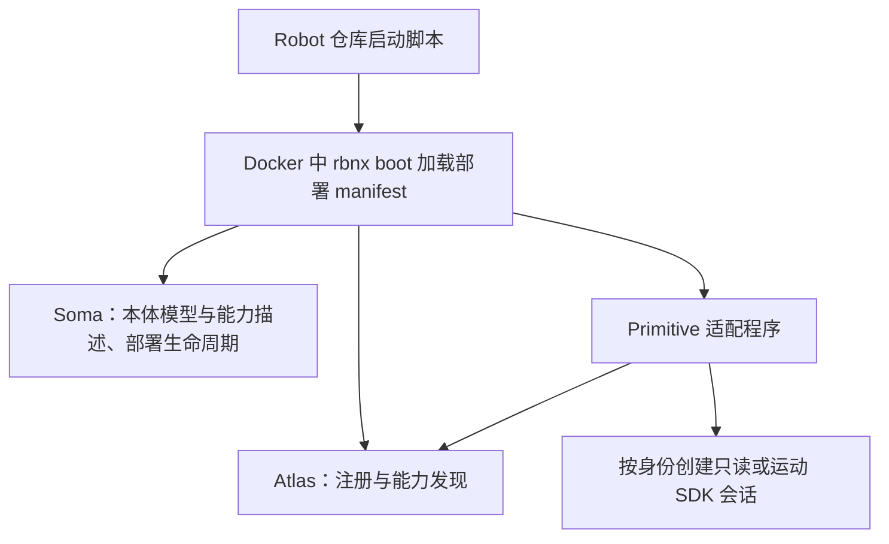
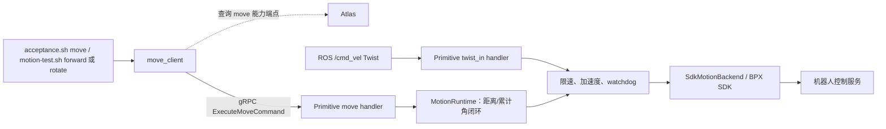
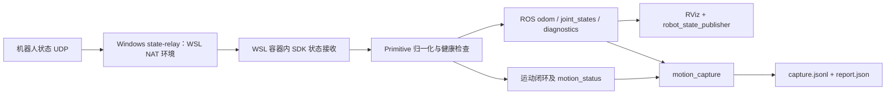

# BPX 接入 Robonix：当前链路与交付边界

> 2026-10-23：dev.3 正式入口已统一 odom + posture + move + twist_in，
> 同一 SDK owner，无 arm 前置约束。标准姿态 RPC 与 move 互斥；只读模式保留。
> 见 UNIFIED_TEST_GUIDE.md。以下 dev.2 和 motion-test 身份描述属于旧部署；配套 tag 为 v0.1.0-dev.3，发布范围见 RELEASE_NOTES.md。


更新：2026-10-21。REMAINING_TESTS.md 本轮人工验收已按操作者确认通过。

## 两个仓库

| 仓库 | 职责 |
| --- | --- |
| primitive-mirrorme-bpx-quadruped-rbnx | 硬件适配：SDK 会话、反馈归一化、ROS 发布、Robonix 能力接口、运动闭环和故障状态机 |
| robot-mirrorme-bpx | 整机装配：部署 manifest、Soma/URDF、Docker 启动、网络转发、人工测试及验收采集 |

两个仓库当前修改均位于 codex/offline-handoff 工作区，基于远端
feature/operator-cli-odom-handoff；本轮修改尚未 commit/push。

## 启动与发现



`start-sdk-read-only-docker.sh` 默认只读；motion-test.sh start 明确选择独立运动
测试身份。脚本选择 wheel、网络和 ROS_DOMAIN_ID，生成实际部署清单。
Atlas 供客户端解析能力端点，不是每条速度指令都经过它转发；Soma 不计算运动轨迹。

## 命令链路



- `robonix/primitive/quadruped/move`：有界距离/角度或定时速度请求。
- `robonix/primitive/quadruped/twist_in`：ROS 连续速度入口；人工 ros2 topic pub 可直接进入该入口。
- 距离/角度模式依据反馈计算剩余量，不是仅以距离除以速度估算发送时长。
- 当前旋转 move 不设平移距离门限；反转、反馈异常、时限和停止保护保留。

本地操作另走一条链路：

```text
motion-test.sh arm/stop/status/clear-fault/release/stand/sit
  → docker exec → local_control
  → 容器内 Unix socket /tmp/bpx-motion-control.sock
  → MotionRuntime
```

这些是本适配的本地操作者工具，不是 Robonix 远程标准解锁接口。
2026-10-22 已移除手动 arm 前置约束和租期。ACTIVE 且反馈健康、已站立时，新请求准备 SDK；
move 结束归零并禁用 SDK 速度，下一条请求无需 arm。故障仍须显式恢复，不重放旧指令。
内部 ARMED/DISARMED 表示 SDK 控制准备状态，不是上层必调接口。stop/disarm 中止当前动作；
持续禁用请调用 DEACTIVATE 或 shutdown。旧 arm 命令只作兼容入口，motion_lease_s 已无约束效果。
release 关闭 SDK 会话，shutdown 停止外层部署。发布身份的 stand/sit 则有独立标准
posture RPC，并非必须借助 motion-test 的本地 stand/sit。

## 反馈、可视化与验收



relay 是 Windows/WSL 网络适配工具，不是所有 Linux 部署必需的 Robonix 组件。
`acceptance.sh move` 既调用 move 又采集；`acceptance.sh observe` 只采集，move 无需手动 arm；observe 不发运动请求。
采集工具不创建第二个 SDK owner。`analyze_acceptance.py` 离线分析，不发送控制。

`start-rviz.sh` 在本机打开 RViz 并启动 robot_state_publisher，用真实 JointState
驱动模型；不发速度或姿态。当前 base_link 固定视图用于机体/关节显示。真实 SDK
profile 的 odom TF 默认关闭，可选 IMU 也不会因人工验收文档通过而自动启用。
Soma body exports 描述能做什么，不等同于 ROS topic 自动全部成为 Robonix capability。

## 身份与后续交付

| 身份 | 当前能力 |
| --- | --- |
| 默认 dev.3 发布清单 | odom + stand/sit posture + twist_in + move；固定远端 tag |
| SDK 只读 | odom 与内部 ROS 状态，不开放运动 |
| 本地 motion-test | odom + twist_in + move，无需本地 arm，保留的旧运动测试身份 |
| fake/replay | 无真机 SDK 的离线验证 |

本轮人工验收可结束，无需为了勾选重复动作。正式交付仍需独立处理：

1. 两个仓库配套 v0.1.0-dev.3；Robot 固定引用 Primitive 同名 tag。新版本合并 master
   后由已收录的 Catalog 索引默认清单；无需重复提交收录条目。
2. 发布范围为统一四能力入口，免 arm 与待命反馈恢复；现场基础串接由操作者确认通过，
   离线故障恢复通过。测试范围与材料限制见 RELEASE_NOTES.md。
3. 归档实际外参/协方差/尺寸、机器人时基定义、完整 SDK 许可证与静态依赖资料、
   最终生产主机证据。人工接受与可复核技术材料分别记录，不用占位值冒充实测结果。
