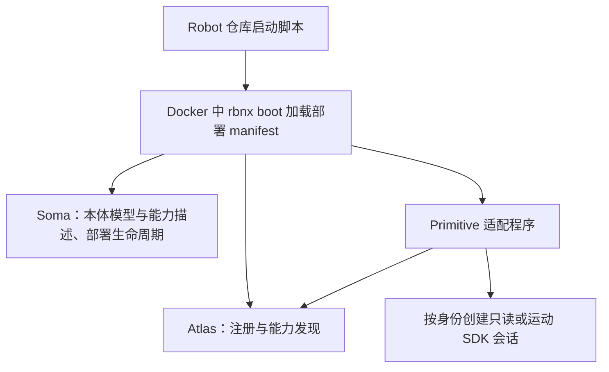
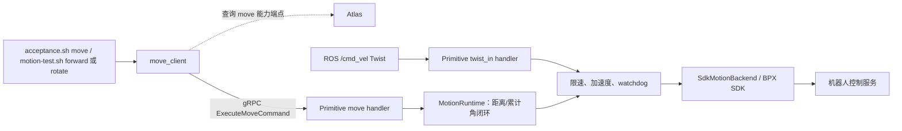
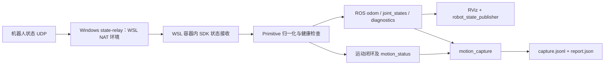

# BPX 接入 Robonix：当前链路与交付边界

更新：2026-10-21。REMAINING_TESTS.md 本轮人工验收已按操作者确认通过。

## 两个仓库

| 仓库 | 职责 |
| --- | --- |
| primitive-mirrorme-bpx-quadruped-rbnx | 硬件适配：SDK 会话、反馈归一化、ROS 发布、Robonix 能力接口、运动闭环和故障状态机 |
| robot-mirrorme-bpx | 整机装配：部署 manifest、Soma/URDF、Docker 启动、网络转发、人工测试及验收采集 |

两个仓库当前修改均位于 codex/offline-handoff 工作区，基于远端
feature/operator-cli-odom-handoff；本轮修改尚未 commit/push。

## 启动与发现



`start-sdk-read-only-docker.sh` 默认只读；motion-test.sh start 明确选择独立运动
测试身份。脚本选择 wheel、网络和 ROS_DOMAIN_ID，生成实际部署清单。
Atlas 供客户端解析能力端点，不是每条速度指令都经过它转发；Soma 不计算运动轨迹。

## 命令链路



- `robonix/primitive/quadruped/move`：有界距离/角度或定时速度请求。
- `robonix/primitive/quadruped/twist_in`：ROS 连续速度入口；人工 ros2 topic pub 可直接进入该入口。
- 距离/角度模式依据反馈计算剩余量，不是仅以距离除以速度估算发送时长。
- 当前旋转 move 不设平移距离门限；反转、反馈异常、时限、租期和停止保护保留。

本地操作另走一条链路：

```text
motion-test.sh arm/stop/status/clear-fault/release/stand/sit
  → docker exec → local_control
  → 容器内 Unix socket /tmp/bpx-motion-control.sock
  → MotionRuntime
```

这些是本适配的本地操作者工具，不是 Robonix 远程标准解锁接口。
运动租期默认 30s，从 arm 开始；move 结束 disarm；恢复连接不会自动 arm。
release 关闭 SDK 会话，shutdown 停止外层部署。发布身份的 stand/sit 则有独立标准
posture RPC，并非必须借助 motion-test 的本地 stand/sit。

## 反馈、可视化与验收



relay 是 Windows/WSL 网络适配工具，不是所有 Linux 部署必需的 Robonix 组件。
`acceptance.sh move` 既调用 move 又采集；`acceptance.sh observe` 只采集，均不自动 arm。
采集工具不创建第二个 SDK owner。`analyze_acceptance.py` 离线分析，不发送控制。

`start-rviz.sh` 在本机打开 RViz 并启动 robot_state_publisher，用真实 JointState
驱动模型；不发速度或姿态。当前 base_link 固定视图用于机体/关节显示。真实 SDK
profile 的 odom TF 默认关闭，可选 IMU 也不会因人工验收文档通过而自动启用。
Soma body exports 描述能做什么，不等同于 ROS topic 自动全部成为 Robonix capability。

## 身份与后续交付

| 身份 | 当前能力 |
| --- | --- |
| 默认 dev.2 发布清单 | odom + 精确 stand/sit posture；固定远端 tag |
| SDK 只读 | odom 与内部 ROS 状态，不开放运动 |
| 本地 motion-test | odom + twist_in + move，仍需本地 arm，未加入默认发布能力 |
| fake/replay | 无真机 SDK 的离线验证 |

本轮人工验收可结束，无需为了勾选重复动作。正式交付仍需独立处理：

1. 整理并提交两个仓库的修改，审核后推送/发布新版本；默认清单的远端 tag 不会自动
   包含本地修改。当前没有自动提交、推送或变更发布身份。
2. 如目标是远程连续任务编排，另行确定正式运动授权机制和能力发布范围；目前每个
   move 结束 disarm、本地 30s 租期仍限制无人值守任务。这不因验收通过自动取消。
3. 归档实际外参/协方差/尺寸、机器人时基定义、完整 SDK 许可证与静态依赖资料、
   最终生产主机证据。人工接受与可复核技术材料分别记录，不用占位值冒充实测结果。
